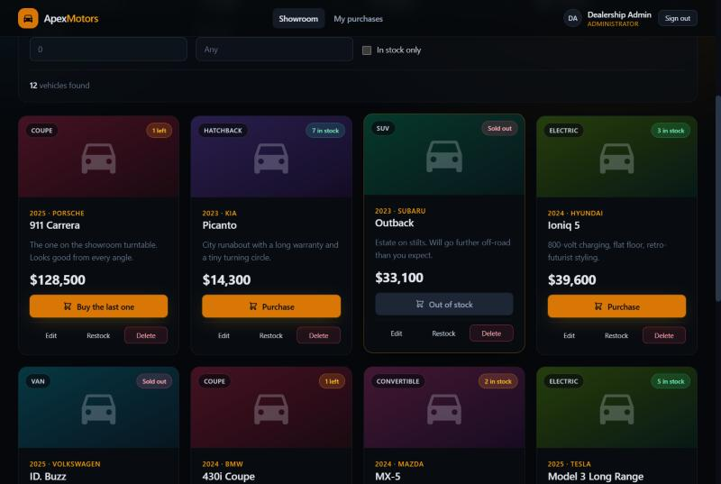
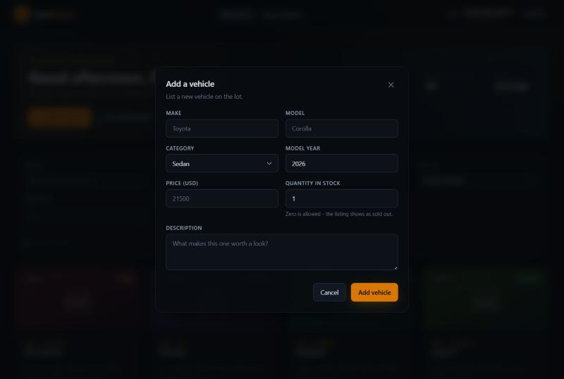
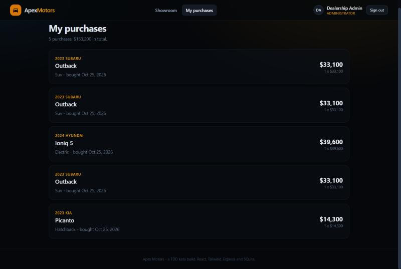
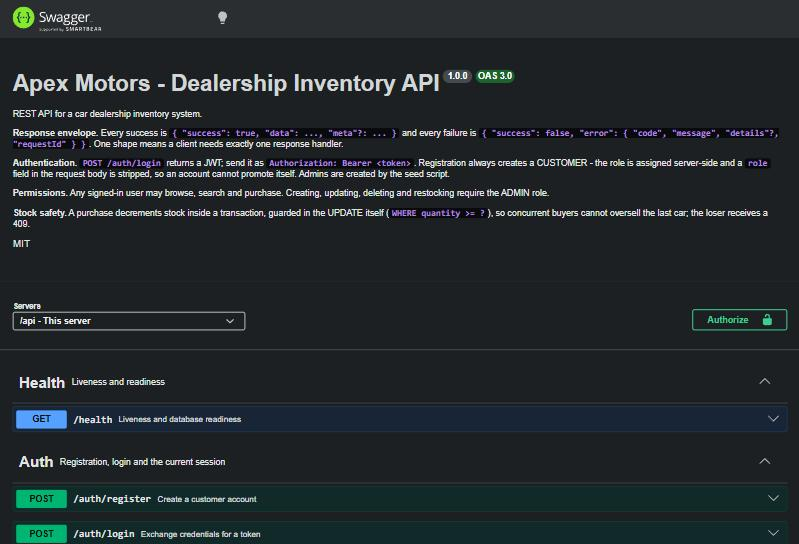
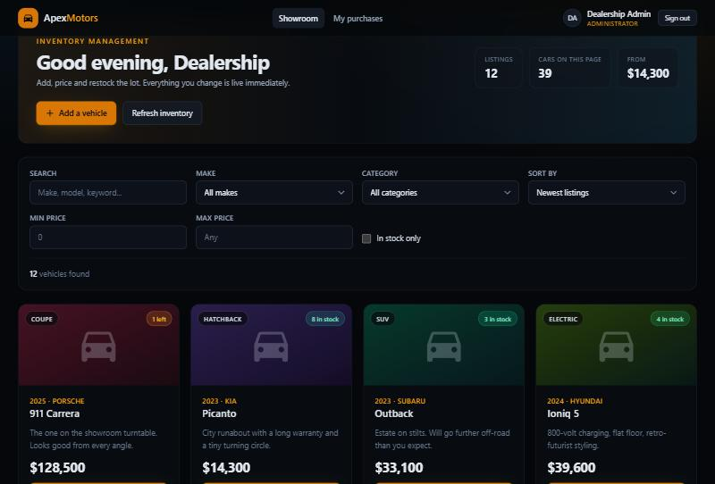

# Apex Motors — Car Dealership Inventory System

A full-stack dealership inventory application: a REST API with JWT authentication and
role-based permissions, backed by a real SQLite database, and a React single-page app for
browsing, searching, buying and managing the lot.

Built test-first. The backend was driven out by tests written before the code they
describe, and the git history shows the Red → Green → Refactor loop one commit at a time.

| | |
| --- | --- |
| **Backend** | Node.js · TypeScript · Express · SQLite (better-sqlite3) · JWT · Zod |
| **Frontend** | React 18 · TypeScript · Tailwind CSS v4 · React Router · Vite |
| **Quality** | **252 tests** · **96.2% backend coverage** · ESLint (type-aware) · Prettier · GitHub Actions |
| **Deploy** | One Docker container — the API serves the built SPA |

---

For folder descriptions, restored local files and command explanations, see the [project guide](docs/PROJECT-GUIDE.md).

## Table of contents

- [Screenshots](#screenshots)
- [Running it locally](#running-it-locally)
- [Demo accounts](#demo-accounts)
- [API reference](#api-reference)
- [Architecture](#architecture)
- [How TDD was actually applied](#how-tdd-was-actually-applied)
- [Testing](#testing)
- [Deployment](#deployment)
- [Design decisions worth explaining](#design-decisions-worth-explaining)
- [My AI Usage](#my-ai-usage)
- [Project structure](#project-structure)

---

## Screenshots

### Sign in
Split-screen auth with one-click fills for the seeded demo accounts.


### The showroom (admin view)
Greeting, live inventory stats, admin actions, the filter bar and the vehicle grid.


### Vehicle grid, including a sold-out listing
Stock badges are colour-coded (`4 in stock` / `1 left` / `Sold out`). The sold-out
Subaru's purchase button is genuinely disabled and clearly greyed out, while its admin
controls stay available so it can be restocked.



### Search and filter
Category `Electric`, sorted by price. The bar reports the match count — as a live region,
so the change is announced rather than purely visual — and offers *Clear filters* once
anything is applied.


### Admin: add a vehicle
One form serves add and edit, including an optional photo URL. Server-side validation
errors come back mapped to the field that caused them.



### Admin: restock


### My purchases
Every purchase keeps the price that was actually paid, even if the listing is repriced or
removed later.



### Interactive API documentation
`/api/docs` serves Swagger UI over the OpenAPI document, which is checked against the
router on every test run.



### Production build, one service
The compiled API serving the built SPA from a single process — the deployment path.



### Responsive
The whole app collapses to a single column on a phone.


---

## Running it locally

**Prerequisites:** Node.js 20 or newer (built and tested on 20 and 22) and npm.

### Option A — Docker, one command

```bash
JWT_SECRET=$(openssl rand -hex 32) docker compose up --build
```

Seed the demo data once (the compiled seed script ships in the image):

```bash
docker compose exec app node dist/db/seed.js
```

Then open <http://localhost:4000> — the API serves the frontend, so there is only one port
and no CORS to configure.

### Option B — two terminals (the development setup)

**1. Backend**

```bash
cd backend
npm install
cp .env.example .env     # Windows PowerShell: copy .env.example .env
npm run seed             # creates the database, demo accounts and 12 vehicles
npm run dev              # http://localhost:4000
```

Check it:

```bash
curl http://localhost:4000/api/health
```

**2. Frontend**

```bash
cd frontend
npm install
cp .env.example .env     # Windows PowerShell: copy .env.example .env
npm run dev              # http://localhost:5173
```

Open <http://localhost:5173> and sign in with a demo account below.

### Everything else

```bash
# Backend
npm test                 # 180 tests
npm run test:coverage    # with a v8 coverage report
npm run lint             # type-aware ESLint
npm run format:check
npm run typecheck        # sources *and* tests
npm run migrate          # apply migrations without seeding
npm run build && npm start

# Frontend
npm test                 # 72 tests
npm run lint
npm run build            # typecheck + production bundle
npm run preview
```

### Configuration

`backend/.env` — every variable is validated at start-up, so a bad value fails
immediately instead of surfacing as a confusing runtime error.

| Variable | Default | Purpose |
| --- | --- | --- |
| `PORT` | `4000` | API port |
| `NODE_ENV` | `development` | `development` \| `test` \| `production` |
| `JWT_SECRET` | *(required)* | Signing secret, minimum 8 characters |
| `JWT_EXPIRES_IN` | `2h` | Access-token lifetime |
| `BCRYPT_ROUNDS` | `10` | Password hashing cost |
| `DATABASE_PATH` | `./data/dealership.db` | SQLite file, created on first run |
| `CORS_ORIGIN` | `http://localhost:5173` | Comma-separated origins, or `*` |
| `AUTH_RATE_LIMIT_WINDOW_MS` | `900000` | Throttle window for credential endpoints |
| `AUTH_RATE_LIMIT_MAX` | `10` | Failed attempts per IP per window |
| `TRUST_PROXY` | `false` | Only enable behind a real reverse proxy |
| `SERVE_SPA` | `false` | Single-service mode: also serve the built frontend |
| `SPA_DIST_PATH` | `../frontend/dist` | Where that build lives |
| `SEED_ADMIN_EMAIL` | `admin@dealership.test` | Admin created by `npm run seed` |
| `SEED_ADMIN_PASSWORD` | `Admin123!` | Password for that admin |

`frontend/.env` — `VITE_API_URL`, default `http://localhost:4000/api`. Production builds
use `/api` via `.env.production`; see the note in that file about why it is a file rather
than a command-line variable.

---

## Demo accounts

Created by `npm run seed`. Local development credentials — change
`SEED_ADMIN_PASSWORD` before deploying anywhere real.

| Role | Email | Password | Can do |
| --- | --- | --- | --- |
| Admin | `admin@dealership.test` | `Admin123!` | Everything: add, edit, delete, restock |
| Customer | `customer@dealership.test` | `Customer123!` | Browse, search, buy, see own purchases |

Anyone can register at `/register`; new accounts are always customers. **Registration can
never create an admin** — the role is assigned by the service and a `role` field in the
request body is stripped before it is ever read. Admins exist only because the seed script
creates them.

---

## API reference

Base URL `http://localhost:4000/api`. Protected routes expect `Authorization: Bearer <token>`.

**Interactive documentation is at [`/api/docs`](http://localhost:4000/api/docs)**, with the
raw OpenAPI document at `/api/openapi.json`. The tables below are a summary; the spec is
the contract, and a test compares it against the router in both directions on every run.

Every response uses one envelope:

```jsonc
// success
{ "success": true, "data": { /* ... */ }, "meta": { /* optional */ } }

// failure
{ "success": false, "error": { "code": "VALIDATION_ERROR", "message": "Validation failed",
  "details": [{ "field": "price", "message": "Price is required" }],
  "requestId": "0f8c…" } }
```

### Auth

| Method | Path | Access | Description |
| --- | --- | --- | --- |
| `POST` | `/auth/register` | public | Create a customer account, returns a token |
| `POST` | `/auth/login` | public | Exchange credentials for a token |
| `GET` | `/auth/me` | signed in | The current user — used to restore a session |

Both credential endpoints are rate limited (failed attempts only).

### Vehicles

| Method | Path | Access | Description |
| --- | --- | --- | --- |
| `GET` | `/vehicles` | signed in | List vehicles, paginated |
| `GET` | `/vehicles/search` | signed in | Filtered search (see below) |
| `GET` | `/vehicles/filters` | signed in | Distinct makes and categories, for dropdowns |
| `GET` | `/vehicles/:id` | signed in | A single vehicle |
| `POST` | `/vehicles` | **admin** | Add a vehicle |
| `PUT` | `/vehicles/:id` | **admin** | Update a vehicle (partial body) |
| `DELETE` | `/vehicles/:id` | **admin** | Delete a vehicle |

### Inventory

| Method | Path | Access | Description |
| --- | --- | --- | --- |
| `POST` | `/vehicles/:id/purchase` | signed in | Buy, decreasing stock. Body `{ "quantity": 1 }` |
| `POST` | `/vehicles/:id/restock` | **admin** | Add stock. Body `{ "quantity": 5 }` |
| `GET` | `/purchases/me` | signed in | The caller's own purchase history |

`GET /api/health` is public and genuinely queries the database.

### Search parameters

`q`, `make`, `model`, `category`, `minPrice`, `maxPrice`, `minYear`, `maxYear`,
`availableOnly`, `sort` (`newest` · `oldest` · `price_asc` · `price_desc` · `year_desc` ·
`year_asc`), `page`, `limit` (max 100).

```bash
curl "http://localhost:4000/api/vehicles/search?make=toyota&minPrice=20000&maxPrice=40000&availableOnly=true&sort=price_asc" \
  -H "Authorization: Bearer $TOKEN"
```

`make` and `model` match partially and case-insensitively; `category` matches exactly but
case-insensitively; `q` searches across make, model, category and description. Filters
combine with AND, and `meta` carries `total`, `page`, `limit` and `totalPages`.

### Status codes

`200` OK · `201` created (including a purchase, which creates a ledger entry) ·
`204` deleted · `400` malformed JSON · `401` missing/invalid token · `403` wrong role ·
`404` unknown resource · `409` duplicate listing or insufficient stock ·
`413` body too large · `422` validation failed, with per-field details ·
`429` too many credential attempts · `503` database unreachable.

---

## Architecture

```
HTTP  ─▶  routes          declare the permission model (authenticate, requireAdmin)
          controllers     parse and validate input, call a service, shape the response
          services        the business rules — no Express, no SQL
          repositories    all SQL, mapping rows to domain objects
          SQLite          constraints as the last line of defence
```

Each layer only knows about the one below it, through an interface rather than a concrete
dependency:

- **`createApp(db, options)` takes a database handle** instead of opening one. That single
  decision is what lets the integration tests run the *real* application against a
  throwaway database file, with no mocking of Express and no shared state between test
  files. The options argument extends the same idea to the rate limiter and to
  single-service mode, both of which are therefore testable without a container.
- **`buildContainer(db)` is the only place wiring happens.** Every class receives its
  collaborators through its constructor, so nothing reaches for a module-level singleton.
- **Services depend on repositories, not on `better-sqlite3`.** Swapping SQLite for
  Postgres means rewriting the repository files and nothing else.
- **Errors are thrown, not rendered.** Services throw `NotFoundError`, `ConflictError`,
  `ForbiddenError`; one error middleware is the only place that turns an error into a
  status code.
- **Validation lives at the edge.** Zod schemas parse untrusted input in the controller, so
  every layer below can assume its inputs are well-formed.

---

## How TDD was actually applied

The commit history is the evidence. Tests were committed *first*, in a failing state, then
the implementation that makes them pass:

```
test: specify the database schema before writing it (RED)
feat: add migrating SQLite database layer (GREEN)
test: specify auth primitives and AuthService behaviour (RED)
feat: implement auth primitives, user repository and AuthService (GREEN)
test: specify the auth HTTP contract end to end (RED)
feat: expose auth over HTTP with JWT middleware (GREEN)
test: specify the vehicle catalogue and search rules (RED)
feat: add vehicle catalogue with filtered, paginated search (GREEN)
refactor: enforce the vehicle natural key in the database too (REFACTOR)
test: specify stock movement rules before implementing them (RED)
feat: add atomic purchase and restock with a purchase ledger (GREEN)
test: specify the vehicle and inventory HTTP contract (RED)
feat: expose vehicle CRUD, search and inventory endpoints (GREEN)
```

Each `RED` commit was verified failing before the matching `GREEN` commit was written. The
cycle paid for itself in three places in particular:

1. **The SQL wildcard test.** Writing `expect(service.search({ make: '%' }).total).toBe(0)`
   *before* the query builder existed is what forced LIKE patterns to escape `%`, `_` and
   `\` with an `ESCAPE` clause. Written afterwards, that test would probably never have
   been thought of.
2. **The oversell test.** "never lets stock go negative, however many buyers compete for it"
   ruled out the obvious read-then-write implementation before it was typed, and produced
   the guard-in-the-`WHERE`-clause design instead.
3. **The privilege-escalation test.** Asserting that `register({ role: 'ADMIN' })` still
   returns a customer pinned down a security property as executable documentation.

The `REFACTOR` commit is a genuine one: the make/model/year uniqueness rule already worked
in the service, and was pushed down into a unique database index so no future code path can
bypass it. Same behaviour, stronger guarantee, tests still green.

---

## Testing

```bash
cd backend  && npm run test:coverage   # 180 tests
cd frontend && npm test                # 72 tests
```

**252 tests, all passing.** Full output, per-file coverage and a breakdown of what each
suite covers: **[docs/TEST-REPORT.md](docs/TEST-REPORT.md)**.

| Metric | Backend coverage |
| --- | --- |
| Statements | 96.15% |
| Branches | 85.76% |
| Functions | 97.19% |
| Lines | 96.15% |

Integration tests drive the real Express app through Supertest against a real, file-backed
SQLite database — each test file gets its own in a temp directory, so suites never
interfere with each other or with development data. Nothing is mocked at the HTTP or
database boundary.

Two checks are themselves tested, because **a test that cannot fail is worse than no
test**: the OpenAPI drift check was verified by injecting a fictional endpoint into the
spec and a fictional route into the router and confirming the right test failed each time,
and the route-table helper it relies on has its own test so it cannot silently return an
empty list and pass vacuously.

CI (GitHub Actions) runs lint, format, typecheck, tests and build for both packages on Node
20 and 22, then boots the *compiled* server and waits for `/api/health`, then builds the
Docker image, runs it, and checks the API, the SPA and a JSON 404 on an unknown API route.

---

## Deployment

The API knows how to serve the built SPA (`SERVE_SPA=true`), so this deploys as **one
service**: no CORS configuration, no second URL, no two deploy targets for one application.

```bash
# Local, with Docker
JWT_SECRET=$(openssl rand -hex 32) docker compose up --build   # http://localhost:4000

# Without Docker
cd frontend && npm run build
cd ../backend && npm run build
SERVE_SPA=true JWT_SECRET=... NODE_ENV=production node dist/server.js
```

`render.yaml` is a ready blueprint for [Render](https://render.com) — Docker runtime,
health check path, generated `JWT_SECRET`, and a persistent disk so the database survives a
deploy. Any Docker host works the same way; the only required variable is `JWT_SECRET`.

**Verified locally**, since Docker is not installed on the machine this was built on: the
production bundle and compiled server were run together on one port and exercised through
the browser — sign-in, inventory, `/api/docs` — and the screenshots above are from that
run. The container itself is built and smoke-tested by CI rather than by hand.

> **Not deployed to a public URL.** The optional live-demo deliverable would need hosting
> credentials I do not have; everything needed to deploy is in the repository.

---

## Design decisions worth explaining

**A purchase ledger, not just a counter.** `POST /purchase` writes a row recording who
bought what, how many, and the unit price *at the time*. Decrementing a number would have
satisfied the brief, but it loses the receipt; snapshotting the price means repricing or
deleting a listing never rewrites a buyer's history (the history query `LEFT JOIN`s, so a
deleted listing still shows up as a past purchase).

**Overselling is impossible, not merely unlikely.** The stock guard is part of the
`UPDATE`:

```sql
UPDATE vehicles SET quantity = quantity - ? WHERE id = ? AND quantity >= ?
```

paired with a transaction around the decrement and the ledger insert, and a
`CHECK (quantity >= 0)` constraint underneath. If two buyers race for the last car, exactly
one `UPDATE` reports a changed row; the other gets a `409`.

**Writes are admin-only across the board.** The brief marks only `DELETE` and `restock` as
admin-only, but it also asks for admin-only add/update UI, so `POST` and `PUT` are
restricted too. Customers browse and buy.

**Login failures are deliberately indistinguishable.** A wrong password and an unknown
email return the same `401` and the same message, so the endpoint cannot be used to
enumerate registered emails.

**Only failed credential attempts are rate limited.** An attacker guessing passwords
hammers one endpoint; a user browsing the lot hammers all the others. Limiting everything
equally would punish the second to inconvenience the first, and counting *successful*
logins would lock out a shared office IP.

**A vehicle's natural key is make + model + year.** Listing the same model-year twice is a
restock, not a second listing, so it returns `409` — enforced in the service *and* by a
unique index on `(lower(make), lower(model), year)`.

**Photo URLs are restricted to http(s).** `z.string().url()` happily accepts
`javascript:` and `data:` URLs, and the value ends up in an ``.

**Every error carries a request id**, echoed in `X-Request-Id`, so a user can quote one
string and it can be found in the logs. A caller-supplied id is honoured — traces span
services — but validated first, because reflecting an unchecked header into a response is a
header-injection foothold.

**Known limitations**, stated plainly: tokens are stored in `localStorage` (simple and
appropriate here, though an httpOnly cookie resists XSS better); there is no refresh-token
flow, so a session ends after `JWT_EXPIRES_IN`; the rate limiter keeps its counters in
memory, so it is per-process and resets on restart; vehicle photos are URLs rather than
uploads; and SQLite is a single-writer database, which suits a dealership but would not
suit a high-write service.

---

## My AI Usage

I used **Claude (via Claude Code, the CLI/desktop agent)** throughout this project. Every
commit that involved AI assistance carries a `Co-authored-by: Claude` trailer, and the raw,
unedited session log is in **[PROMPTS.md](PROMPTS.md)**.

### What I used it for

**Boilerplate and scaffolding — the bulk of it.** Package manifests, `tsconfig`, Vitest and
ESLint configuration, the Express router and controller wiring, repository row-mapping
functions, React component shells, Tailwind class strings, inline SVG icons, the Dockerfile
and the CI workflow. This is mechanical code where an AI is simply faster than typing, and
where mistakes are caught immediately by the type checker and the tests.

**Expanding test cases from a checklist.** This was the highest-value use. I would decide
*what* needed proving — "search must not let a user type `%` and get the whole inventory",
"two buyers racing for the last car must not both succeed" — and ask for the cases to be
written out, including the table-driven ones. The judgement about which properties matter
stayed mine; the typing did not.

**Rubber-ducking design decisions.** Where to put the stock guard (service check versus
`WHERE` clause), whether purchases deserved their own table, how to keep authorisation out
of the controllers, whether to deploy as one container or two.

**Debugging.** Six real bugs, none of which was caught by reading the code:

1. `parseOrThrow` was generic over the payload rather than the schema, so schemas that
   *transform* their input (`"sedan"` → the `SEDAN` enum member, `"true"` → a boolean)
   handed callers the raw request type. Caught by `tsc`.
2. A disabled primary button rendered as near-black text on no background at all, because
   my own `disabled:hover:bg-inherit` utility wiped the background whenever a disabled
   button was hovered. Found by inspecting the sold-out card's computed style in a real
   browser and seeing `rgba(0, 0, 0, 0)`.
3. The modal focus trap filtered focusable elements by `offsetParent !== null` — which is
   `null` for *everything* inside a `position: fixed` container. The list collapsed to one
   element and focus was trapped on it. jsdom exposed it; it would have been broken in
   production too.
4. Leaving the Price field blank listed a car for **$0**, because `Number('') === 0`. Found
   by using the running app, which left a free Audi in my development database.
5. The resulting error then read *"Expected number, received nan"*, because
   `z.coerce.number()` runs `Number()` over everything and an absent value never reaches
   `required_error`.
6. `VITE_API_URL=/api npm run build` in Git Bash got rewritten by MSYS path conversion into
   `C:/Program Files/Git/api` and baked into the bundle as the API base URL. The browser
   console showed it trying to `fetch` a `file://` path.

And one bug in a **test**: my first OpenAPI drift check probed each documented endpoint over
HTTP and flagged 404s. I injected a fictional endpoint to confirm it worked — and it passed.
Everything under `/vehicles` sits behind authentication, which answers 401 before routing,
so a nonexistent route is indistinguishable from a real one. It was replaced with a check
that reads Express's own route table, and verified by injecting drift in both directions.

### What I did *not* delegate

The architecture (the layering, dependency injection through `createApp(db)` and
`buildContainer`, the error taxonomy), the database schema and its constraints, the
permission model, the deployment shape, and — most importantly — **the decision about what
to test**. An AI will cheerfully write a hundred tests that assert the implementation back
at you. Deciding that *atomicity*, *price snapshotting* and *email enumeration* were the
properties worth pinning down is the part that made the suite useful.

### Reflection

AI changed the *distribution* of my time rather than simply reducing it. Far less went on
boilerplate and syntax; considerably more went on deciding what the system should guarantee,
reviewing generated code, and chasing the bugs above. That trade is worth making, but only
with guardrails: `strict` TypeScript, type-aware linting, tests written before the
implementation, and running the real application rather than trusting that generated code
works.

The pattern across those seven bugs is the lesson. Not one was found by reading — several
were *generated confidently*, with sensible-looking comments explaining their intent, and
the `disabled:hover:bg-inherit` one even had a comment describing what it was supposed to
do. They were found by a type checker, a linter, a test that failed, and a browser. AI makes
producing plausible code fast, so the verification layer has to get *stronger*, not weaker.
The one that worries me most is the drift test: a test that looked right, passed, and
checked nothing. Writing a test and then deliberately breaking the code to confirm the test
notices is a habit worth keeping whoever — or whatever — wrote it.

---

## Project structure

```
.
├── backend/
│   ├── src/
│   │   ├── config/env.ts            Zod-validated environment, parsed once
│   │   ├── db/                      migrations, connection, transactions, seed
│   │   ├── repositories/            all SQL (user, vehicle, purchase)
│   │   ├── services/                business rules (auth, vehicle, inventory)
│   │   ├── controllers/             HTTP adapters
│   │   ├── routes/                  routers + the permission model
│   │   ├── middleware/              auth, rate limit, request id, logging,
│   │   │                            error handler, SPA serving
│   │   ├── validation/              Zod request schemas
│   │   ├── docs/openapi.ts          the API contract
│   │   ├── utils/                   errors, password, token, response envelope
│   │   ├── container.ts             composition root
│   │   ├── app.ts                   createApp(db, options)
│   │   └── server.ts                process entry point
│   └── tests/
│       ├── unit/                    schema, password, token, the three services
│       ├── integration/             endpoints, hardening, SPA mode, docs drift
│       └── helpers/                 throwaway database, test app, route table
├── frontend/
│   ├── src/
│   │   ├── lib/                     API client, formatters
│   │   ├── context/                 Auth and Toast contexts + providers
│   │   ├── hooks/                   useAuth, useToast, useVehicles
│   │   ├── components/              ui primitives, vehicle components, layout,
│   │   │                            ProtectedRoute, ErrorBoundary
│   │   ├── pages/                   login, register, showroom, purchases, 404
│   │   └── index.css                design tokens (Tailwind v4 @theme)
│   └── tests/                       client, card, filters, form, modal,
│                                    error boundary, session
├── .github/workflows/ci.yml         lint, test, build, boot, Docker smoke test
├── Dockerfile                       three-stage, single-service image
├── docker-compose.yml               one command to run it all
├── render.yaml                      deploy blueprint
├── docs/
│   ├── TEST-REPORT.md               full suite output and coverage
│   └── screenshots/
├── PROMPTS.md                       raw, unedited AI session log
└── README.md
```

---

Built as a TDD kata. The interesting parts are the test suite and the commit history —
`git log --oneline` tells the story better than this README does.

Licensed under the [MIT License](LICENSE).
